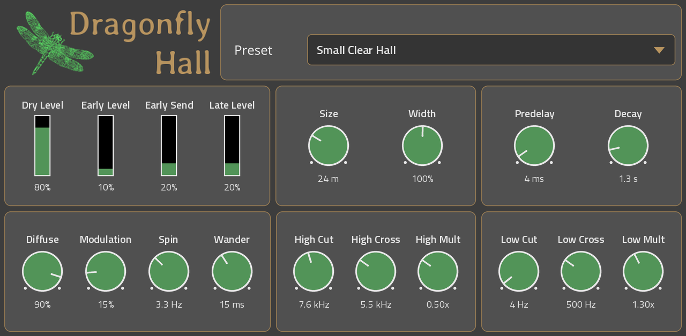
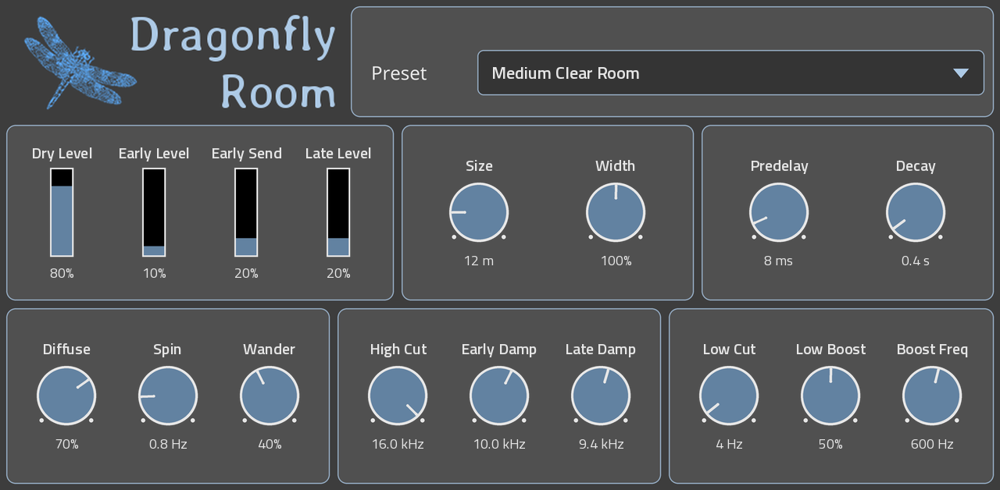
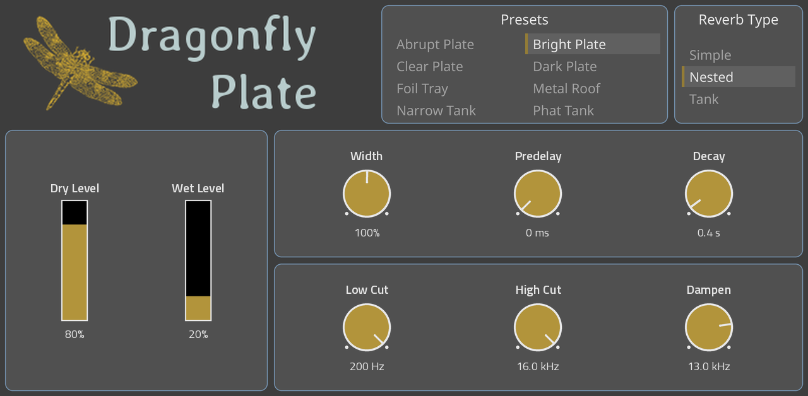
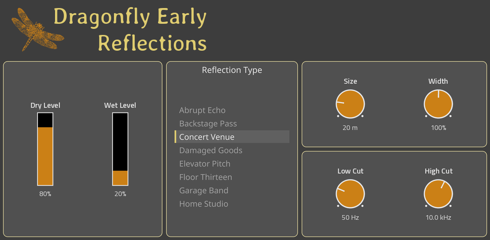

# Dragonfly Reverb for MPC OS

An unofficial port of the four [Dragonfly Reverb](https://github.com/michaelwillis/dragonfly-reverb) plugins (3.2.10) by Michael Willis and
Rob van den Berg, ported as native insert effects for Akai MPC and Akai Force standalone devices: **Gen1** (32-bit: Force, MPC Live,
Live II, One, X, Key 61) and **Gen2** (64-bit: MPC Live III, One G2, Key G2). Each has a touchscreen page modelled on
the original plugin's UI, Q-Link mapping, its presets, and full project recall. The DSP is upstream's, compiled
with upstream's own flags, and null-tested against upstream's binary ([docs/SOUND.md](docs/SOUND.md)).



| Plugin (manufacturer "Dragonfly") | Presets |
|---|---|
| **Hall** | 25, in 5 banks; Q-Link banks MAIN and EQ |
| **Room** | 25, in 5 banks; Q-Link banks MAIN and TONE |
| **Plate** | 8, plus 3 reverb types |
| **Early Reflections** | 8 reflection types |

## Install
Two ways, from the same [Releases](../../releases). Use one per device (see [docs/CATALOG.md](docs/CATALOG.md)).

**From the [MPC OS Plugin Catalog](https://sd88me.github.io/mpc-vst-plugins/)**: each reverb is listed from its own
repo ([Hall](https://github.com/gmorb/mpc-vst-dragonfly-hall), [Room](https://github.com/gmorb/mpc-vst-dragonfly-room),
[Plate](https://github.com/gmorb/mpc-vst-dragonfly-plate),
[Early Reflections](https://github.com/gmorb/mpc-vst-dragonfly-early-reflections)); the same zips are on this repo's
releases. Each is a zip with an `install.sh`; the zip's `INSTALL.md` has the steps. Gen1: `<Name>-<version>-mpc-armv7.zip`;
Gen2: `<Name>-<version>-mpc-aarch64.zip` (the installer refuses the wrong one; the catalog's installers pick the right
one). Same plugin ids and parameters on both, so projects move between generations.

**Force VST plugins distribution**: download `Dragonfly-Reverb-for-MPC-OS-<version>.zip`. It follows the Force VST
plugins distribution layout ([docs/DISTRIBUTION.md](docs/DISTRIBUTION.md)): one self-contained folder per plugin.

Gen1 only. Requires a Gen 1 Akai Force or MPC with SSH access (modded firmware such as MockbaMod) and the distribution's
`Synths` folder with `vstscanner.sh`. The steps are written for the **Akai Force with MockbaMod**, which mounts its
memory card at `/media/662522`:

1. Copy the four `Dragonfly - VST - ...` folders into `/media/662522/Synths` (next to `vstscanner.sh`).
2. On the device: `sh /media/662522/Synths/vstscanner.sh` (afterwards just `vstscanner`). MPC restarts; the
   plugins are under VST, manufacturer "Dragonfly".

Other custom firmware (for example Hakai), or no `662522` card: put the folders in a `Synths` folder on any drive
under `/media` (e.g. `/media/az01-internal/Synths`), find MPC's settings file (`find / -name MPC.settings`), and
run `sh <that Synths folder>/vstscanner.sh <settings path>`. The release's README has the full steps, updating
from 1.1.x, and troubleshooting.

## Screenshots
| Room | Plate | Early Reflections |
|---|---|---|
|  |  |  |

Rendered from the built pages by `tools/screenshot.py`, at the default settings. The spectrograms are computed at
build time per preset, exactly as upstream's (`vst/spectrogram_dump.cpp` + `vst/df_paint.py`), and follow the
selected preset.

## Status
Alpha. Everything is tested offline (below), including the real ARM binaries under emulation. 1.3.0 is tested on
an Akai Force (Gen1) and an MPC Live III (Gen2), both MPC OS 3.9.1 (`tested.json`); the other models of each generation
share the same OS and plugin host. CPU load per instance has not been measured on a device yet; Hall is the heaviest of the four (instruction
counts under emulation: docs/SOUND.md).

## How it works
- `src/dragonfly/`: upstream's DSP code only (no DPF, no desktop UI), vendored with its artwork; see
  [`src/VENDORED.md`](src/VENDORED.md) for the exact commit and the one local fix. `src/shim/` stands in for the
  three DPF headers the DSP includes.
- `vst/dsp_glue.cpp`: the only file that sees upstream's headers; a small C API per plugin (`vst/dsp_glue.h`).
- `vst/dragonfly_vst.cpp`: a hand-written VST2 **effect** wrapper (stereo in/out, no Steinberg SDK), with the
  parameter conventions of [mpc-vst-plugins](https://github.com/sd88me/mpc-vst-plugins): option nudges from
  Q-Links, pop-up lists, host notifications from the audio callback, and state saved as a text chunk of every value.
- Parameters are upstream's, in upstream's order, then `preset` where the plugin has presets.
  `vst/dump_params.cpp` writes each `params.json` from upstream's `DistrhoPluginInfo.h`, so the list can't drift.
  Never reorder them: MPC stores values by index.
- Pages: `vst/df_skin.py` holds one page spec per plugin and writes `vst/<p>/layout.conf` (generated; edit the
  spec). The kit's `gen_vst.py` builds the skin, then `vst/df_paint.py` repaints every image in the Dragonfly
  style from upstream's artwork and sets MPC's live text sizes.
- Targets: Gen1 armv7-a with NEON + VFPv4 (Cortex-A17: every Gen1 unit is an RK3288), hard-float, Thumb-2;
  Gen2 aarch64 (armv8-a). The C++ runtime is linked in; only `VSTPluginMain` is exported; glibc <= 2.36.
- Compiler flags: upstream's DSP gets upstream's own `-O3 -ffast-math` (with `-ffp-contract=off`, as its x86 build
  has no FMA); the VST wrapper stays strict IEEE. Fast-math decides some of Hall's and Room's delay lengths, so this
  is what makes them the original's ([docs/SOUND.md](docs/SOUND.md)).

## Build
```
git clone https://github.com/sd88me/mpc-vst-plugins ../mpc-vst-plugins
git -C ../mpc-vst-plugins checkout c0394f0352d77072f345bd929d26c6fc09bc34a0   # the commit CI uses
pip install ziglang==0.16.0 pillow numpy
TOOLCHAIN=zig vst/build.sh          # all four, Gen1 + Gen2; or: vst/build.sh hall plate; ARCHS=armv7 for Gen1 only
```
Needs python3, a host gcc/g++, and Zig (above; what CI uses). `TOOLCHAIN=docker` (`arm32v7/gcc:12` and
`arm64v8/gcc:12-bookworm`, the kit's standard) is also wired up but not exercised by CI. Output per plugin is in
`vst/<p>/build/` (Gen1) and `vst/<p>/build/aarch64/` (Gen2). Set `MPC_VST` if the kit isn't at `../mpc-vst-plugins`.

## Test
```
sudo apt install qemu-user libc6-armhf-cross libc6-arm64-cross   # to also test the real Gen1/Gen2 binaries
vst/test.sh
tools/null_test.sh                  # does it sound like the original? (docs/SOUND.md)
```
`vst/effect_test.c` loads a plugin the way MPC does and checks: instances, the stereo effect ABI, every parameter's
name, display and round trip, option nudges, every preset (loads, reports to the host, renders sane audio), the
pop-up, impulse to finite decaying tail, silence, in-place and legacy processing, odd block sizes, chunk
save/restore, foreign chunks refused, 48 kHz, a parameter sweep during playback, and that the host's FPU mode is
left alone. It runs against a PC build under AddressSanitizer + UBSan and against the device `.so` files under
qemu-arm (Gen1) and qemu-aarch64 (Gen2).

`tools/null_test.sh` renders every preset (`vst/render.c`) through both device builds and through a PC build of the
same sources with upstream's x86 flags, and null-tests them against each other; when apt can fetch Ubuntu's
`dragonfly-reverb-vst` (upstream's own build), it also checks that reference is bit-identical to it.

## Package and release
- `tools/package.sh` builds `dist/Dragonfly-Reverb-for-MPC-OS-<VERSION>.zip` in the distribution layout
  ([docs/DISTRIBUTION.md](docs/DISTRIBUTION.md)), `dist/SHA256SUMS` and the release
  notes (from this version's `CHANGELOG.md` section).
- `tools/screenshot.py <plugin> <out.png>` renders a page as MPC lays it out, for `docs/screenshots/`.
- The same run builds the catalog's per-plugin zips, Gen1 and Gen2, with the kit's `tools/release.py` and checks
  them with its `catalog_check.py` (needs `CATALOG_OWNER=owner` locally, e.g. `gmorb`; CI uses the repo's owner). Each
  zip names its per-plugin repo (`<owner>/mpc-vst-<id>`) as its source repo, as the catalog requires. The pages come from the
  pinned kit (`MPC_VST`); the packaging tools can come from a newer one (`MPC_VST_RELEASE`; CI pins both). `tools/catalog_entries.py`
  writes the catalog registry entries. See [docs/CATALOG.md](docs/CATALOG.md).
- CI (`.github/workflows/build.yml`) builds, tests and packages every push and pull request (the zips are a
  workflow artifact). To release: bump `VERSION` (X.Y.Z), add its section to `CHANGELOG.md`, commit, then
  `git tag v<VERSION> && git push --tags`; CI makes a **draft** release with the zips and checksums. Test the
  zips on a device, then publish it.

## Credits and licence
Dragonfly Reverb by Michael Willis and Rob van den Berg; freeverb3 by Teru Kamogashira and others; Noto Sans by
Google. Built with [mpc-vst-plugins](https://github.com/sd88me/mpc-vst-plugins). Not affiliated with or endorsed
by the Dragonfly Reverb authors or by Akai Professional / inMusic.

GPL-3.0-or-later ([LICENSE](LICENSE)), as Dragonfly Reverb. Every component, its authors and licence:
[NOTICE.md](NOTICE.md). Release zips include `NOTICE.md` and the licence texts (`licenses/`).
